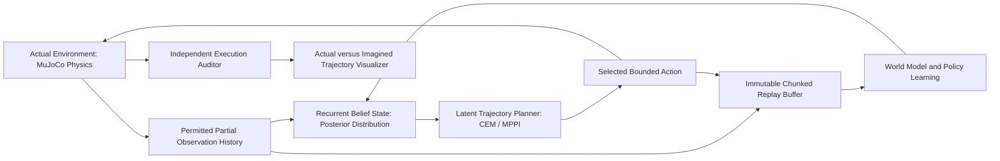

# Kinesis: Learned World Models for Partially Observed Control

Kinesis is an experimental laboratory for learned latent dynamics, belief state inference, and epistemic uncertainty-aware trajectory planning in continuous control environments subject to hidden physical parameter shifts.

## Scientific Investigation

Robotic policies deployed in real environments regularly face unmodeled latency, degraded sensor streams, actuator deadbands, and altered contact friction. When dynamics models are learned from nominal data, trajectory optimizers often exploit model inaccuracies, steering systems into high-risk regimes where predictions fail catastrophically.

Kinesis investigates two core questions:
1. Does penalizing epistemic uncertainty (measured via ensemble disagreement in latent transitions) during latent planning prevent catastrophic control degradation under hidden shifts in friction, actuation delay, and mass?
2. What is the empirical gap between one-step predictive accuracy and multi-step closed-loop control success under partial observability?

## Core System Architecture



The system strictly enforces an information boundary:
* The planner and policy only observe declared partial observations (delayed, noisy, or masked sensor channels).
* True physics states, true simulator parameters, and future observations are never provided during online planning.
* The simulator is never stepped or cloned to evaluate candidate futures during latent planning.

## Key Mechanisms

1. **Stochastic Recurrent World Model (RSSM)**: Decomposes state into a deterministic recurrent vector (GRU) and a stochastic latent state parameterized by Gaussian distributions. Employs KL balancing and free bits to stabilize latent representations.
2. **Epistemic Uncertainty Penalization**: Maintains an ensemble of transition models. Candidate trajectories that exhibit high variance across ensemble predictions receive explicit penalties during scoring.
3. **Latent Trajectory Optimization**: Implements Cross-Entropy Method (CEM) and Model Predictive Path Integral (MPPI) planning over imagined latent rollouts without simulator interactions.
4. **Declared Physical Shift Profiles**: Systematically benchmarks nominal environments alongside six frozen shift regimes spanning actuator delay, torque attenuation, contact friction shifts, and sensor dropout.
5. **Independent Audit and Verification**: Closed-loop returns, constraint costs, and termination events are computed independently from raw execution traces, accompanied by twelve negative verification controls.

## Supported Benchmark Environments

Kinesis supports continuous control tasks from the DeepMind Control Suite:
* `cartpole/swingup`: Pendulum inversion and balance under torque and joint friction variations.
* `walker/walk`: Bipedal planar locomotion with complex foot-ground contact transitions.
* `finger/spin`: Continuous planar manipulation under fingertip-object contact dynamics.

## Quickstart

### Prerequisites
* Python 3.12
* PyTorch 2.1+
* MuJoCo 3.1+
* dm_control 1.0.14+

### Installation

```bash
git clone https://github.com/Aneesh495/kinesis-control.git
cd kinesis-control
make bootstrap
make doctor
make build
```

### Running Tests

```bash
make test
make test-control
```

### Executing Closed-Loop Training and Evaluation

```bash
# Train world model and policy on nominal cartpole
make train TASK=cartpole_swingup SEED=42

# Evaluate across nominal and shifted profiles
make evaluate RUN_ID=cartpole_run_42

# Run full acceptance and verification suite
make acceptance RUN_ID=acceptance_bundle_01
make verify EVIDENCE=evidence/acceptance_bundle_01
```

## Repository Structure

```
├── docs/                 # Architectural specifications, ADRs, derivations, build status
├── src/kinesis/          # Core library
│   ├── contracts/        # Versioned transition and episode data contracts
│   ├── envs/             # Environment adapters and physics probing
│   ├── observations/     # Partial observability, noise, and delay wrappers
│   ├── shifts/           # Declared physical parameter shifts
│   ├── analytic/         # Deterministic linear Gaussian control fixtures
│   ├── replay/           # Bounded immutable sequence replay
│   ├── collection/       # Parallel environment collection runtime
│   ├── models/           # Recurrent world models, encoders, decoders
│   ├── uncertainty/      # Ensemble disagreement and epistemic scoring
│   ├── planning/         # Latent CEM and MPPI trajectory optimizers
│   ├── policies/         # Baseline and learned policies
│   ├── training/         # Loss objectives, optimization, and target networks
│   ├── closed_loop/      # Online closed-loop control loop
│   ├── evaluation/       # Benchmark campaign and error gap analysis
│   ├── viewer/           # Trajectory visualization and rendering
│   └── artifacts/        # Verification harness and negative controls
├── tests/                # Test suites across all subsystems
└── Makefile              # Standard automation targets
```

## License
MIT License.
