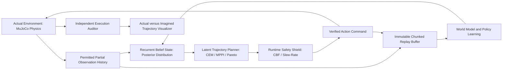

# Kinesis: Learned World Models for Partially Observed Control

Kinesis is an experimental laboratory for learned latent dynamics, belief state inference, and epistemic uncertainty-aware trajectory planning in continuous control environments subject to hidden physical parameter shifts.

## Scientific Investigation

Robotic policies deployed in real environments regularly face unmodeled latency, degraded sensor streams, actuator deadbands, and altered contact friction. When dynamics models are learned from nominal data, trajectory optimizers often exploit model inaccuracies, steering systems into high-risk regimes where predictions fail catastrophically.

Kinesis investigates two core questions:
1. Does penalizing epistemic uncertainty (measured via ensemble disagreement in latent transitions) during latent planning prevent catastrophic control degradation under hidden shifts in friction, actuation delay, and mass?
2. What is the empirical gap between one-step predictive accuracy and multi-step closed-loop control success under partial observability?

## Core System Architecture



The system strictly enforces an information boundary:
* The planner and policy only observe declared partial observations (delayed, noisy, or masked sensor channels).
* True physics states, true simulator parameters, and future observations are never provided during online planning.
* The simulator is never stepped or cloned to evaluate candidate futures during latent planning.

## Key Mechanisms and Modules

1. **Stochastic Recurrent World Model (RSSM)**: Decomposes state into a deterministic recurrent vector (GRU) and a stochastic latent state parameterized by Gaussian distributions. Employs KL balancing and free bits to stabilize latent representations.
2. **Geometric and Invertible Priors**: Features Symplectic Hamiltonian Neural Networks (HNN) with volume-preserving leapfrog integration and RealNVP normalizing flows for exact multi-modal transition densities.
3. **Epistemic Uncertainty Quantification**: Implements deep ensemble disagreement, Monte Carlo dropout, Deep Evidential Regression for closed-form epistemic/aleatoric decomposition, and distribution-free conformal prediction intervals.
4. **Advanced Latent Trajectory Planners**:
   * Cross-Entropy Method (CEM) and Model Predictive Path Integral (MPPI).
   * Covariance Matrix Adaptation Evolution Strategy (CMA-ES).
   * Latent Monte Carlo Tree Search (MCTS) with PUCT tree policy.
   * Multi-objective Pareto frontier optimizer balancing reward, risk, and actuation effort.
   * Risk-sensitive entropic and Conditional Value-at-Risk (CVaR) planners.
   * Temporal warm-start horizon caching and deduplicated rollout hashing.
5. **Runtime Safety and Certified Control**:
   * Runtime safety shield intercepting hazardous actions based on uncertainty and barrier margins.
   * Discrete-time Control Barrier Functions (CBF) and polyhedral invariant constraint set auditors.
   * Actuator slew-rate and acceleration jerk limitation.
   * Discrete Lyapunov stability verification and energy decay certification.
6. **Analytic Fixtures and Frequency Diagnostics**:
   * Discrete Riccati recursion, Kalman filtering, Extended Kalman Filtering, and Unscented Kalman Filtering.
   * Full Differential Dynamic Programming (DDP) with second-order dynamics Hessians.
   * Controllability and observability Gramians.
   * Discrete frequency response Bode and stability margin analyzer.
7. **Causal Twin-World Interventions**: Synchronously steps aligned factual and counterfactual simulations under Pearl's do-calculus to isolate individual treatment effects and finite-time Lyapunov exponents.
8. **Independent Audit and Verification**: Closed-loop returns, constraint costs, and termination events are computed independently from raw execution traces, accompanied by twelve negative verification controls.

## Architectural Decision Records (ADRs)

| ADR | Title | Status |
| :--- | :--- | :--- |
| **0001** | Immutable Transition Contracts and Schema Versioning | Accepted |
| **0002** | Linear Gaussian Fixtures and Riccati Grounding | Accepted |
| **0003** | Physical Parameter Shift Protocol and Probe Verification | Accepted |
| **0004** | Recurrent State-Space Model Inductive Biases | Accepted |
| **0005** | Epistemic Uncertainty Quantification via Ensemble Disagreement | Accepted |
| **0006** | Latent Action Planning with CEM and MPPI Path Integrals | Accepted |
| **0007** | Closed-Loop Privacy Boundary and Zero State Leakage | Accepted |
| **0008** | Cryptographic Acceptance Verification and Negative Controls | Accepted |
| **0009** | Symplectic Hamiltonian Neural Dynamics for Energy Preservation | Accepted |
| **0010** | Normalizing Flow Prior Densities for Multi-Modal Transitions | Accepted |
| **0011** | Runtime Safety Shield and Barrier Function Fallbacks | Accepted |
| **0012** | Counterfactual Twin-World Interventions and Causal Auditing | Accepted |
| **0013** | Polyhedral Invariance and Lyapunov Stability Certificates | Accepted |
| **0014** | Pareto Frontier Optimization for Multi-Objective Risk Planning | Accepted |
| **0015** | Warm-Start Memory Caching for Receding Horizon Optimization | Accepted |
| **0016** | Actuator Slew-Rate and Acceleration Jerk Limitation | Accepted |

## Supported Benchmark Environments

Kinesis supports continuous control tasks from the DeepMind Control Suite:
* `cartpole/swingup`: Pendulum inversion and balance under torque and joint friction variations.
* `walker/walk`: Bipedal planar locomotion with complex foot-ground contact transitions.
* `finger/spin`: Continuous planar manipulation under fingertip-object contact dynamics.

### Declared Shift Profiles

1. `nominal`: Standard unperturbed simulation.
2. `actuator_attenuation`: 50 percent motor torque loss.
3. `actuator_delay`: 2-step transport latency in action application.
4. `friction_reduction`: Sliding friction reduced to 25 percent (slip regime).
5. `mass_increase`: Rigid body masses scaled by 1.8x.
6. `sensor_degradation`: Sensory delay, 15 percent dropout, Gaussian noise std 0.08.
7. `combined_stress`: Concurrent actuation loss, delay, low friction, heavy mass, and noisy sensors.

## Quickstart

### Prerequisites
* Python 3.12
* PyTorch 2.1+
* MuJoCo 3.1+
* dm_control 1.0.14+

### Installation

```bash
git clone https://github.com/Aneesh495/kinesis-control.git
cd kinesis-control
make bootstrap
make doctor
make build
```

### Running Tests

```bash
# Run all unit and integration test suites
make test

# Run analytic control benchmark tests
make test-control

# Run replay buffer tests
make test-replay

# Run stress and fault-injection tests
make stress
```

### Executing Closed-Loop Training and Evaluation

```bash
# Train world model on nominal cartpole
make train TASK=cartpole_swingup SEED=42

# Evaluate across nominal and shifted profiles
make evaluate RUN_ID=cartpole_run_42

# Run full acceptance and independent verification bundle
make acceptance RUN_ID=kinesis_acceptance_v1
make verify EVIDENCE=evidence/kinesis_acceptance_v1
```

## Repository Structure

```
├── docs/                 # Architectural specifications, ADRs, derivations, runbooks
│   ├── adr/              # Architecture Decision Records (0001 - 0016)
│   ├── math/             # Mathematical derivations (RSSM, Riccati, Kalman, DDP)
│   ├── ops/              # Operational runbooks and workflows
│   └── cards/            # Model and dataset cards
├── src/kinesis/          # Core library
│   ├── contracts/        # Versioned transition and episode data contracts
│   ├── envs/             # Environment adapters and physics probing
│   ├── observations/     # Partial observability, noise, and delay wrappers
│   ├── shifts/           # Declared physical parameter shifts
│   ├── analytic/         # Deterministic linear Gaussian fixtures, DDP, Lyapunov, Bode
│   ├── replay/           # Bounded immutable sequence replay and atomic checkpoints
│   ├── collection/       # Parallel environment collection runtime
│   ├── models/           # Recurrent world models, flows, symplectics, jumps
│   ├── uncertainty/      # Ensemble disagreement, conformal prediction, evidential
│   ├── planning/         # Latent CEM, MPPI, CMA-ES, MCTS, Pareto, warm start
│   ├── safety/           # Runtime safety shield, polyhedral sets, slew-rate limiter
│   ├── adaptation/       # Online RLS, dual UKF, meta-adaptation, gain scheduler
│   ├── diagnostics/      # Phase space portraits, spectral analysis, drift detectors
│   ├── policies/         # Baseline, heuristic, and latent actor-critic policies
│   ├── training/         # Loss objectives, optimization, and target networks
│   ├── closed_loop/      # Online closed-loop control loop
│   ├── evaluation/       # Benchmark campaign, twin world, and error gap analysis
│   ├── viewer/           # Trajectory visualization and rendering
│   └── artifacts/        # Verification harness and negative controls
├── tests/                # Test suites across all subsystems
├── evidence/             # Cryptographically verified acceptance bundles
└── Makefile              # Standard automation targets
```

## License
MIT License.
