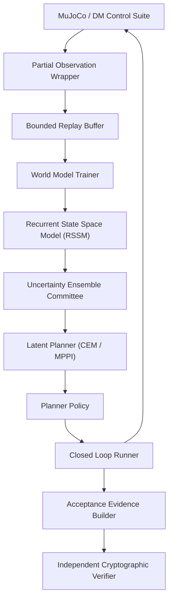
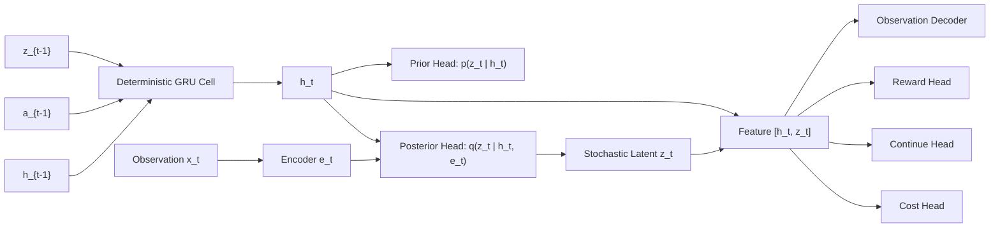
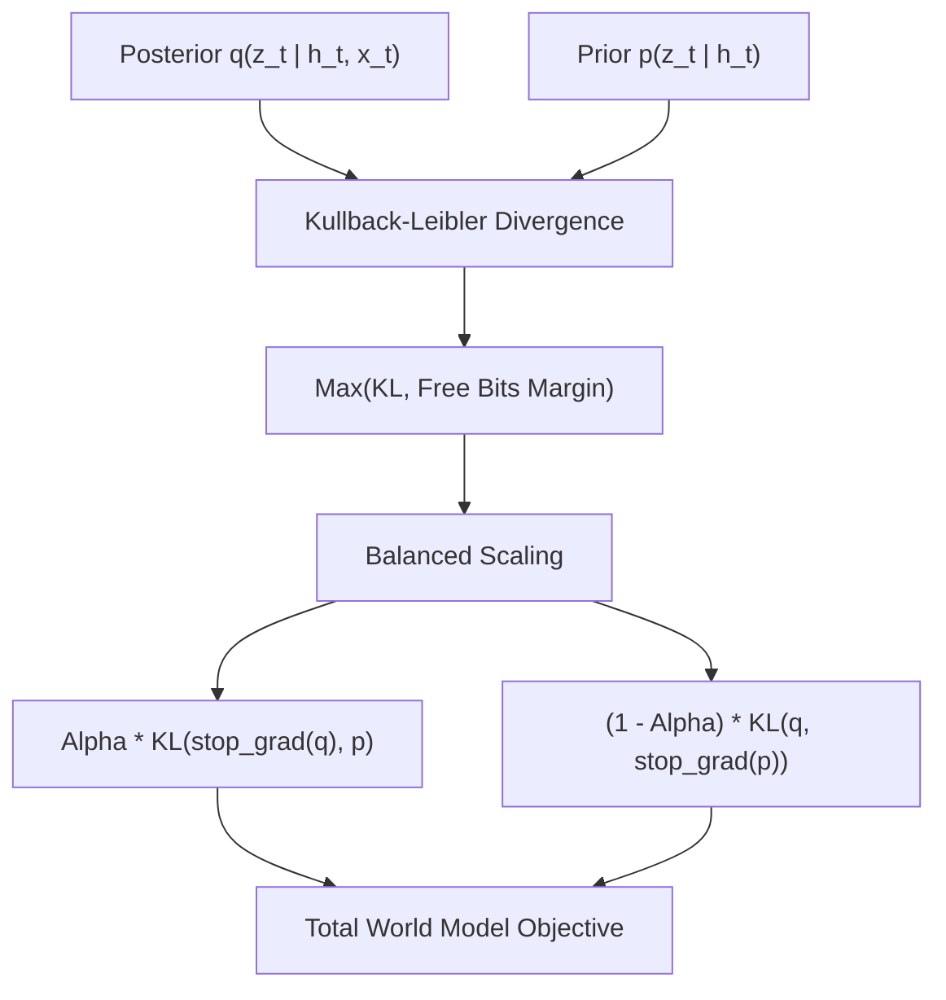
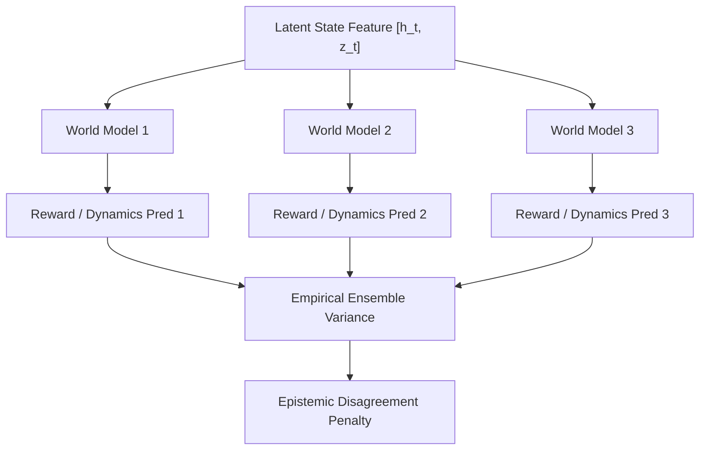
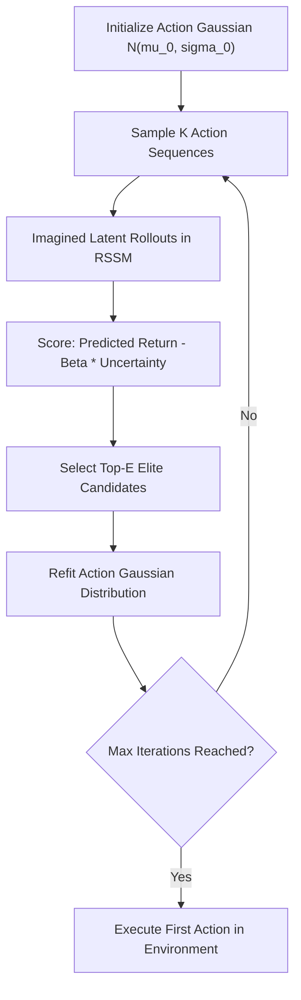
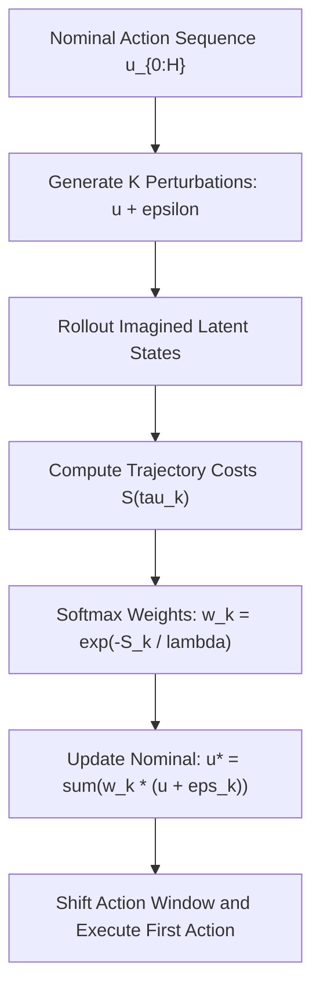
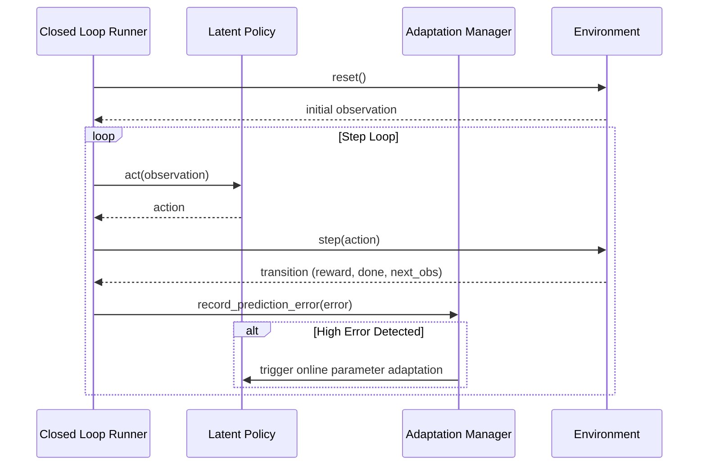
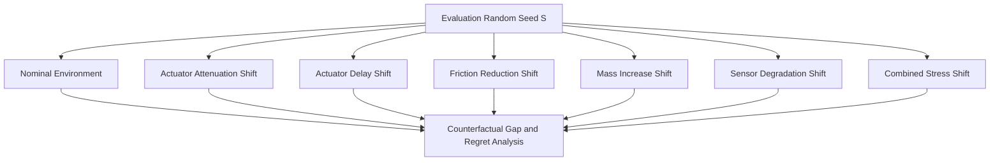
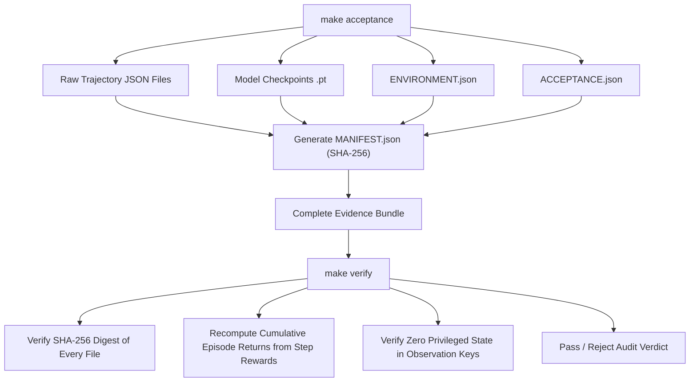

# Kinesis Architecture Specification

This document details the architectural design, component interactions, mathematical contracts, and runtime boundaries of the Kinesis world-model and control laboratory.

## 1. High-Level System Architecture

The Kinesis laboratory is structured into modular layers spanning environment interaction, replay persistence, world-model learning, uncertainty quantification, latent trajectory planning, closed-loop execution, and independent verification.



## 2. Environment Adapter and Information Boundary

The environment layer enforces strict partial observation. Simulator state (including generalized coordinates $q_{pos}$, velocities $q_{vel}$, actuators, and internal contact forces) is strictly confined to environment step transitions. Policy decisions receive only the wrapped partial observation dictionary.

```mermaid
sequenceDiagram
    participant Policy as Policy / Planner
    participant Loop as Closed Loop Runner
    participant Wrap as Observation Wrapper
    participant Sim as DM Control Simulator

    Policy->>Loop: action proposal
    Loop->>Loop: verify privacy (no privileged state)
    Loop->>Sim: step(action)
    Sim-->>Wrap: raw sensor observation (no privileged state)
    Wrap->>Wrap: add delay, noise, and dropout
    Wrap-->>Loop: partial observation dict
    Loop-->>Policy: partial observation dict
```

## 3. Recurrent State-Space Model (RSSM) Architecture

The world model factorizes transition dynamics into a deterministic recurrent path ($h_t$) and a stochastic latent path ($z_t$).

$$h_t = \text{GRU}(h_{t-1}, [z_{t-1}, a_{t-1}])$$
$$q(z_t \mid h_t, x_t) = \mathcal{N}(\mu_{post}(h_t, x_t), \Sigma_{post}(h_t, x_t))$$
$$p(z_t \mid h_t) = \mathcal{N}(\mu_{prior}(h_t), \Sigma_{prior}(h_t))$$



## 4. Balanced KL Divergence Loss and Regularization

To prevent posterior collapse while regularizing the latent representations, training balances gradient updates between the prior and posterior distributions with a free-bits margin.



## 5. Epistemic Uncertainty Quantification via Ensemble Disagreement

Epistemic uncertainty is estimated using an ensemble committee of world models trained with distinct parameter initializations and data mini-batch schedules. Variance across predictions signals epistemic novelty.



## 6. Cross-Entropy Method (CEM) Latent Planning

CEM optimizes action sequences strictly in the learned latent space without interacting with the real simulator.



## 7. Model Predictive Path Integral (MPPI) Control

MPPI samples stochastic perturbations around a nominal control trajectory, computing importance weights via exponential trajectory returns.



## 8. Closed-Loop Execution and Online Adaptation

The closed-loop runner synchronizes policy interaction with environment stepping, logging immutable transition tuples while monitoring for distribution shifts.



## 9. Shift Robustness and Counterfactual Evaluation

Evaluation exercises trained agents against nominal conditions and 6 frozen physical shift profiles across identical paired random seeds.



## 10. Acceptance Bundle Building and Independent Cryptographic Verification

Acceptance bundles record raw trajectory traces, trained model checkpoints, environment manifests, and JSON summaries. Every file is registered with SHA-256 digests in MANIFEST.json.


